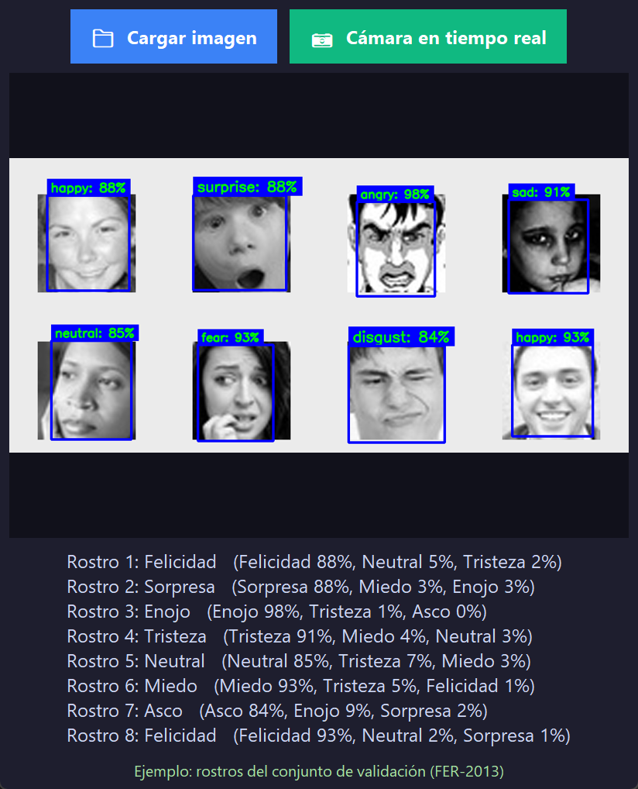
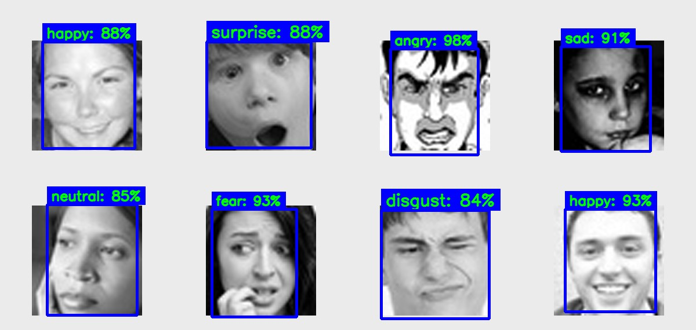

# **Face_Emotion**

Detección de emociones faciales en imágenes y en tiempo real con la webcam, usando una red neuronal convolucional.

Basado en el repositorio de [David Revelo Luna](https://github.com/DavidReveloLuna/Face_Emotion).

  

**Demo original del autor** (detección en tiempo real con la webcam):

  

## Emociones detectadas

  

> Ejemplos tomados del conjunto de validación de FER-2013 y procesados con `modelFEC_v3.h5`.
> Se eligieron caras que el modelo clasifica bien para mostrar cada emoción; en general el modelo v3 acierta ~68 % de las veces (el ensamble actual, ~70 %).

| Clase | Emoción |
|---|---|
| `angry` | Enojo |
| `disgust` | Asco |
| `fear` | Miedo |
| `happy` | Felicidad |
| `neutral` | Neutral |
| `sad` | Tristeza |
| `surprise` | Sorpresa |

## Cómo funciona

1. **Detección de rostros:** red SSD de OpenCV DNN ([face_detector/](face_detector/)).
2. **Clasificación de emociones:** cada rostro se convierte a escala de grises de 48×48 y se clasifica con una CNN.
3. **Test-time augmentation:** se promedia la predicción del rostro original y la del volteado horizontalmente.
4. **Suavizado temporal** (en video): las probabilidades de cada rostro se promedian entre frames para que la etiqueta no parpadee ([emotion_smoothing.py](emotion_smoothing.py)).

## Modelos

| Archivo | Descripción | Precisión en validación |
|---|---|---|
| `modelFEC.h5` | CNN original del autor, entrenada desde cero ([notebook original](https://github.com/DavidReveloLuna/Face_Emotion/blob/master/FaceEmotion.ipynb)) | 64.86 % |
| `modelFEC_v3.h5` | EfficientNetB0 (ImageNet) + fine-tuning, 96 px ([train_transfer.py](train_transfer.py)) | 67.95 % |
| `modelFEC_v4_b2_128_s1.h5` | EfficientNetB2 (ImageNet) + fine-tuning, 128 px | 69.59 % |
| **Ensamble v3 + v4** | Promedio de las predicciones de los dos modelos | **70.46 %** |

*Todas las precisiones de v3, v4 y el ensamble incluyen TTA (promedio con la imagen volteada).*

La app usa el **ensamble**: todos los `modelFEC_v4*.h5` junto con `modelFEC_v3.h5` (~15-20 FPS en CPU).
Si no hay modelos v4, usa solo el v3 (~30 FPS); si tampoco está, el original.

Precisión por emoción (F1) del ensamble:

| Emoción | Original | Ensamble |
|---|---|---|
| Felicidad | 0.84 | 0.89 |
| Sorpresa | 0.79 | 0.81 |
| Asco | 0.66 | 0.74 |
| Neutral | 0.58 | 0.67 |
| Enojo | 0.56 | 0.62 |
| Tristeza | 0.52 | 0.59 |
| Miedo | 0.49 | 0.54 |

## Instalación (Windows, Python 3.12)

    > python -m venv venv
    > venv\Scripts\activate
    > pip install -r requirements.txt

> Los modelos `.h5` se guardaron con Keras 2. El código define `TF_USE_LEGACY_KERAS=1`
> antes de importar tensorflow para usar `tf_keras`.

## Uso

    > python FaceEmotionApp.py

- **Cargar imagen:** detecta todos los rostros de una foto y muestra el top 3 de emociones de cada uno.
- **Cámara en tiempo real:** detección con la webcam (~15-20 FPS en CPU con el ensamble). El mismo botón la detiene.

## Entrenamiento

El dataset (FER-2013, 28,821 imágenes de entrenamiento y 7,066 de validación) está en `images.rar`.

**En Google Colab con GPU (recomendado):** sube [FaceEmotion_Colab.ipynb](FaceEmotion_Colab.ipynb) a Colab,
activa la GPU T4 y ejecuta todo. Por defecto entrena un modelo v4 (EfficientNetB2, 128 px, ~1 h), evalúa el
ensamble con el v3 y descarga el `.h5`. En el paso 3 del notebook se elige la red, el tamaño y cuántos modelos entrenar.

**En la PC:** primero descomprime `images.rar` en la carpeta del proyecto (se crea `images/`), y luego:

    > python train_transfer.py                          # v3: EfficientNetB0, 96 px (~2-3 h en CPU)
    > python train_transfer.py --base b2 --img-size 128 --model modelFEC_v4_s1.h5
    > python train_transfer.py --eval                   # compara el v3 con el modelo original
    > python train_transfer.py --eval --model modelFEC_v3.h5 modelFEC_v4_s1.h5   # cada uno y el ensamble

Opciones útiles: `--seed` (semilla), `--mixed-precision` (solo con GPU NVIDIA) y `--compact` (quita el estado
del optimizador de un `.h5` para que pese menos).

## Estructura del repositorio

| Archivo | Descripción |
|---|---|
| `FaceEmotionApp.py` | Aplicación con interfaz gráfica (Tkinter) |
| `emotion_smoothing.py` | Suavizado temporal de las predicciones en video |
| `train_transfer.py` | Entrenamiento y evaluación de los modelos (v3, v4 y ensambles) |
| `FaceEmotion_Colab.ipynb` | El mismo entrenamiento en Google Colab con GPU |
| `modelFEC_v3.h5`, `modelFEC.h5` | Modelos de emociones (mejorado y original) |
| `face_detector/` | Detector de rostros (SSD, OpenCV DNN) |
| `images.rar` | Dataset FER-2013 |
| `assets/` | Imágenes del README |

# **Canal de Youtube del autor original**
[Click aquí para ver el canal de YOUTUBE](https://www.youtube.com/channel/UCr_dJOULDvSXMHA1PSHy2rg)
